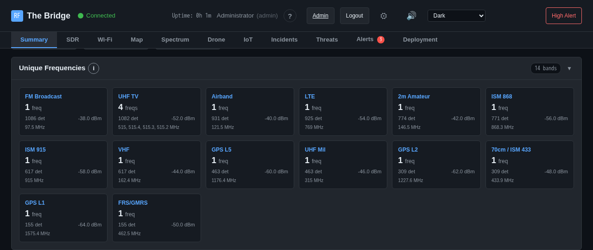
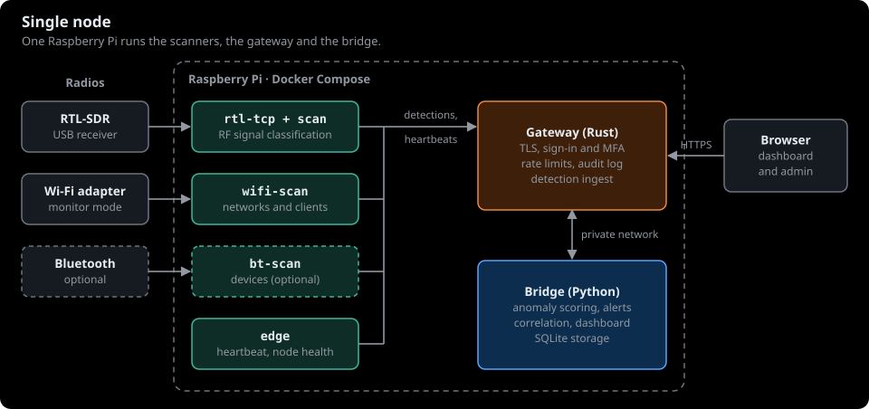
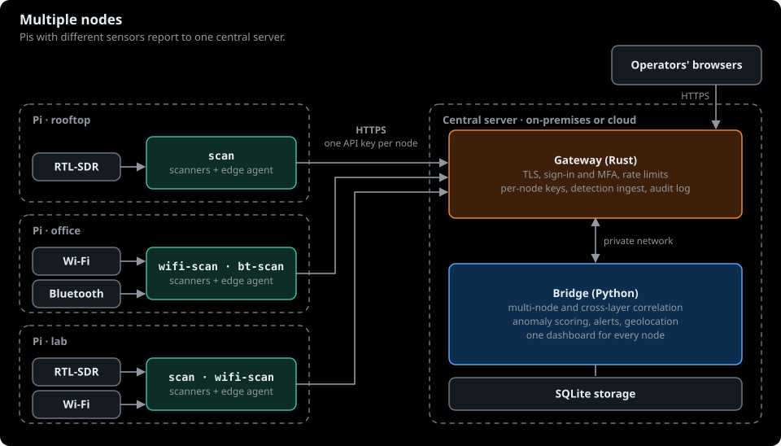
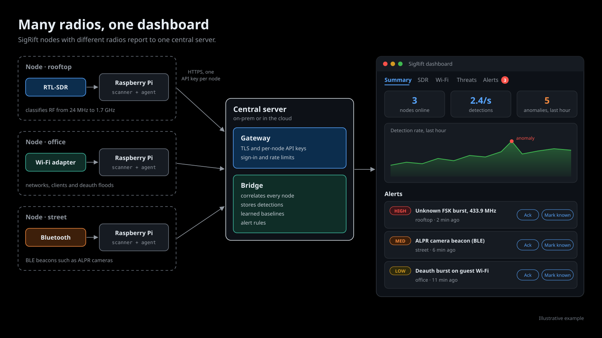
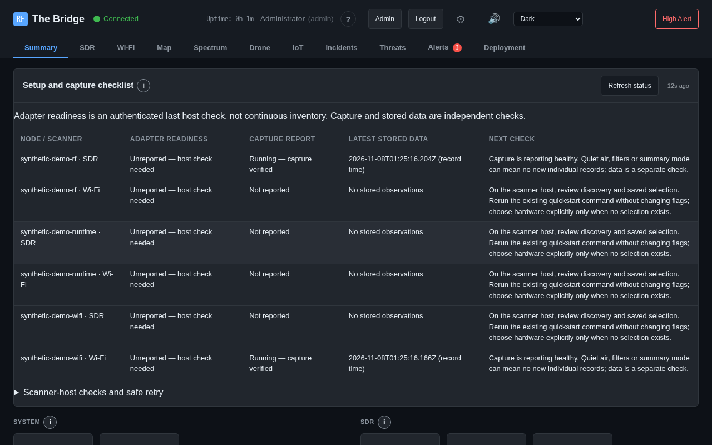
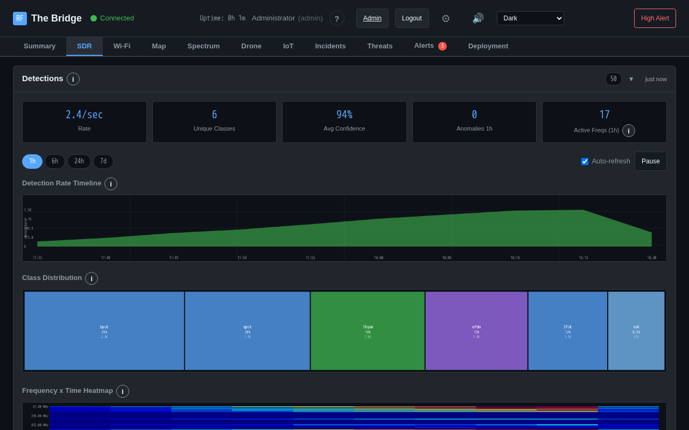
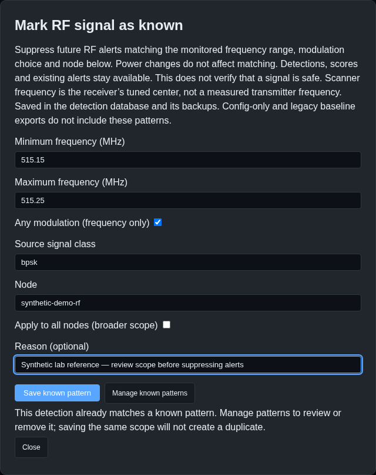

# SigRift (community edition)

[](https://github.com/SigRift/SigRift/actions/workflows/ci.yml)
[](https://github.com/SigRift/SigRift/actions/workflows/build-and-push.yml)
[](https://github.com/SigRift/SigRift/actions/workflows/release.yml)
[](https://github.com/SigRift/SigRift/actions/workflows/codeql.yml)
[](https://github.com/SigRift/SigRift/actions/workflows/gitleaks.yml)

[](https://github.com/SigRift/SigRift/releases)
[](https://github.com/orgs/SigRift/packages?repo_name=SigRift)
[](LICENSE)

**Find devices hiding in your spectrum.** SigRift is a self-hosted RF/TSCM
platform — RTL-SDR, HackRF and USRP hardware feed a multi-node
gateway that classifies modulation, decodes ADS-B, UAT, Meshtastic,
LoRa, DMR, and P25, and flags anomalies against learned
baselines in real time. WiFi + Bluetooth scanners ship in-stack with a
CVE-matched BlueZ vulnerability check.

Built for solo TSCM practitioners, security researchers, and SDR
hobbyists. `scripts/quickstart.sh --dashboard-only` builds a local dashboard
without scanner hardware; the same stack scales to multiple edge
nodes feeding one bridge. MIT-licensed; commercial features (fingerprinting,
fuzzing, OIDC, STIX, TDOA) ship separately in `sigrift-sentinel`.

→ **Start here:** [QUICKSTART.md](QUICKSTART.md) (dashboard setup) ·
[INSTALL.md](INSTALL.md) (full install) ·
[ARCHITECTURE.md](ARCHITECTURE.md) (system overview)



*Synthetic demonstration data in the real application.* [View feature screenshots](docs/images/README.md#feature-gallery) for populated metrics, Wi-Fi discovery, alerts and known-frequency review.

> ## ⚠️ Lawful Use Only
>
> SigRift receives, demodulates, classifies, and decodes radio-frequency
> signals. It decrypts supported protocols with keys the operator
> supplies, and applies the public Meshtastic default-channel keys on its
> own. Its Wi-Fi scanner captures the start of data frames, which on open
> networks includes other people's traffic, and keeps the most recent
> frames in memory (see [LEGAL.md](LEGAL.md) §4 for the full disclosure
> and scope). RF reception and decryption are regulated in every jurisdiction
> (FCC Part 15 / Title 47 in the US, Ofcom / Wireless Telegraphy Act in
> the UK, the EU ePrivacy and national wiretap statutes, ISED in Canada,
> ACMA in Australia, and equivalents elsewhere).
>
> **You are solely responsible for the legality of your use.** SigRift is
> intended for authorized defensive TSCM, licensed spectrum monitoring,
> scoped penetration testing, amateur-radio experimentation within licence
> privileges, and security research on signals you own or that are in the
> public domain. Do **not** use SigRift to intercept non-public
> communications, defeat encryption or access controls, monitor cellular
> or emergency-services traffic, jam or spoof licensed services, or
> conduct covert surveillance of individuals without a lawful basis. If
> you are not authorized to capture Wi-Fi traffic content where you
> operate, run setup with `--scanners=sdr`, `--scanners=none` or
> `--dashboard-only`.
>
> Read [LEGAL.md](LEGAL.md) in full before installing. Installation and
> use constitute acceptance of those terms and the [LICENSE](LICENSE).

## Architecture

SigRift runs the same way at any size. The smallest install is one
Raspberry Pi with its radios attached:



To cover more ground, put Pis with whatever sensors each site needs in
the field and point them at one central server, on your own hardware or in
the cloud. Each node signs in with its own API key, and the server
correlates what all of them see:



Operators then work from one dashboard that covers every node: live
counts, detection trends, and alerts they can acknowledge or mark as known
(illustrative example):



In this release the one-line edge installer sets up only the heartbeat
agent on a remote host; it does not capture RF. Remote scanners are set
up by hand (see [src/sigrift/edge/README.md](src/sigrift/edge/README.md))
and were not part of the release soak.

See [ARCHITECTURE.md](ARCHITECTURE.md) for the data flow in detail and
[QUICKSTART.md](QUICKSTART.md#sdr-on-a-different-host) for adding a remote
node.

The source is laid out as follows:

```
src/
├── sigrift/                       # Python package (PYTHONPATH=src)
│   ├── bridge/                    # FastAPI backend
│   ├── lib/                       # ML models, DSP, taxonomy
│   ├── tools/                     # CLI tools
│   └── edge/                      # Edge node agents (RPi 4/5, RTL-SDR, HackRF)
└── gateway/
    └── crates/
        ├── sigrift-gateway-core/  # Shared library (axum, TLS, auth, MFA,
        │                          # proxy, ingest, audit). No licence code.
        └── sigrift-gateway/       # Community binary. Thin wrapper.

tests/
└── bridge/                        # Python tests
```

**Security boundary:** the Rust gateway handles TLS, authentication, MFA,
and rate limiting. Python handles application logic behind the proxy. See
[SECURITY.md](SECURITY.md) for details.

The community build contains **no licence verification, no signing keys,
and no tier-enforcement code** — it runs at community tier with every
feature available in the binary enabled. A separate commercial edition
layers additional features and their licensing.

## Quick Start

On a native Linux host, connect an RTL-SDR receiver and/or a spare monitor-capable Wi-Fi adapter, then run:

```bash
git clone https://github.com/SigRift/SigRift.git
cd SigRift
scripts/quickstart.sh
```

The first run automatically selects ready local SDR/Wi-Fi hardware, prompts for an admin password and an environment preset, and builds the dashboard plus the selected scanners. Only SDR selection needs a classifier model. Setup protects the SSH/default-route Wi-Fi radio; if several spare adapters are suitable, choose one with `scripts/quickstart.sh --scanners=auto --wifi-interface=wlan1` (replace `wlan1` with your spare adapter). Bluetooth is not selected automatically.

Read any hardware preparation message before continuing. With no ready hardware, setup starts the dashboard and node-heartbeat agent only; a successful dashboard health check does not prove capture. Scanner tabs appear after live capture reports arrive. Plain retries preserve the selected devices and configuration. See [QUICKSTART.md](QUICKSTART.md) for preparation, retries and the Setup and capture checklist.



*The Setup and capture checklist keeps adapter readiness, live capture reports and stored data as separate checks (synthetic demonstration data).*

For Docker Desktop or an intentional hardware-free install, use `scripts/quickstart.sh --dashboard-only` instead. This skips hardware discovery and model downloads and keeps that choice on plain retries. On a supported Linux host, `scripts/quickstart.sh --scanners=auto` enables or rediscovers hardware later; see [scanner setup and limits](QUICKSTART.md#enable-hardware-later).

Prerequisites: a running Docker Engine with Compose, `python3` 3.11+, `openssl`, `curl`, a free TCP port (default 8444), and storage for source-build dependencies, images and persistent data. The first build depends on host and network speed. See [QUICKSTART.md](QUICKSTART.md#prerequisites) for platform and hardware requirements. Pre-built application releases (v0.1.0 and later, with cosign-signed release files) install with `scripts/install-release.sh`; see [Verifying a release](INSTALL.md#verifying-a-release).

**Remote access**, no port forwarding, no public DNS: deploy behind [Tailscale](https://tailscale.com) — 5-minute setup, MagicDNS hostnames, ACLs in the admin console. See [TAILSCALE.md](TAILSCALE.md).

Want to run bridge + gateway manually (e.g. on a Pi without Docker, or for development)? See [INSTALL.md](INSTALL.md) §"Alternative: from-source single-host".

## Tests

For a disposable source-built stack with real browser and API checks, see
[End-to-end candidate run](CONTRIBUTING.md#end-to-end-candidate-run).

```bash
# Python
PYTHONPATH=src python3 -m pytest tests/bridge/ -q --timeout=30

# Rust
cargo test --workspace
```

## Edge nodes

`src/sigrift/edge/node_agent.py` is the heartbeat agent — it reports
node liveness and system metrics to the bridge so the dashboard
knows an edge node is alive. SDR classification on the edge is a
separate service (`sigrift.edge.rf_scan`, run by the in-stack
`scan` container on the default Compose stack).

To run a heartbeat agent on a remote SDR host, see
[QUICKSTART.md §"SDR on a different host"](QUICKSTART.md#sdr-on-a-different-host)
for the one-line installer, or
[INSTALL.md §"Adding an edge agent"](INSTALL.md#adding-an-edge-agent-same-host)
for the from-source path.

## Key Features

- TSCM threat signatures (jammers, bugs, trackers, IMSI catchers, drones)
- Multi-node RF correlation
- Cross-layer SDR / WiFi / Bluetooth correlation
- Anomaly scoring with signature matching
- Known RF patterns: mark a frequency range (any modulation or one class,
  one node or all) as known to stop alerting on it, while detections and
  existing alerts stay available
- FHSS detection (frequency hopping analysis)
- MFA/TOTP authentication (Rust-native, Fernet encryption)
- HMAC-SHA256 tamper-evident audit chain
- RSS-based geolocation
- Provider plugin system for extensibility
- Real-time WebSocket feeds (detections, alerts, spectrum)

<table>
  <tr>
    <td width="66%"></td>
    <td width="34%"></td>
  </tr>
  <tr>
    <td><em>SDR analytics: detection rate, classes, confidence and active frequencies.</em></td>
    <td><em>Marking an RF signal as a known pattern.</em></td>
  </tr>
</table>

*Synthetic demonstration data in the real application.* More in the [feature gallery](docs/images/README.md#feature-gallery).

Advanced features (TDOA geolocation, PHY-layer fingerprinting, protocol
fuzzing, SSO, STIX/TAXII, premium geolocation providers) ship only in
the commercial edition.

## Documentation

- [Application screenshots](docs/images/README.md) — Real UI with synthetic test data
- [ARCHITECTURE.md](ARCHITECTURE.md) — System architecture, data flow
- [SECURITY.md](SECURITY.md) — Security architecture, reporting
  vulnerabilities, env vars
- [TAILSCALE.md](TAILSCALE.md) — Recommended deployment behind
  Tailscale for zero-config remote access
- [PRODUCTION_READINESS.md](PRODUCTION_READINESS.md) — Hardening
  checklist for persistent installs
- [LEGAL.md](LEGAL.md) — Acceptable-use terms, jurisdictional guidance
- [CONTRIBUTING.md](CONTRIBUTING.md) — How to contribute

## License

SigRift (community edition) is licensed under the **MIT License**. See
[LICENSE](LICENSE) for the full text. Private preview builds made before the
switch to MIT were licensed under AGPL-3.0-only (see [NOTICE](NOTICE)).

Copyright (C) 2026 Deepak Mahbubani

A separate commercial edition with additional features is available;
ask about it in [GitHub Discussions](https://github.com/SigRift/SigRift/discussions).

Use of SigRift is subject to the acceptable-use terms in
[LEGAL.md](LEGAL.md). Security vulnerabilities should be reported per
[SECURITY.md](SECURITY.md).
