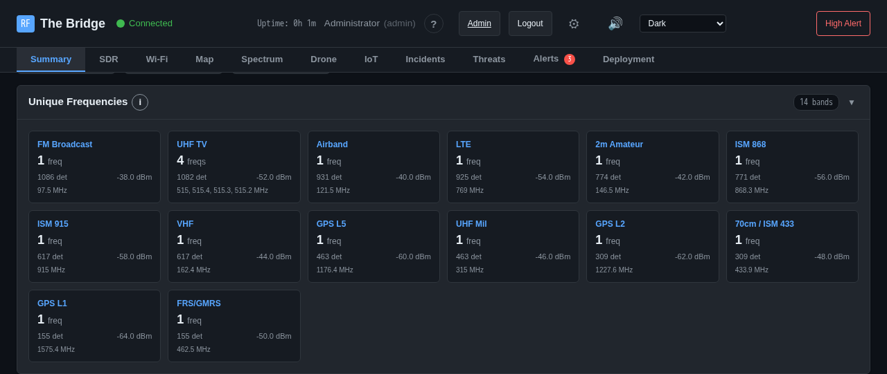
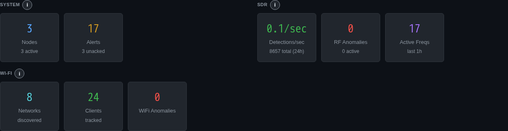
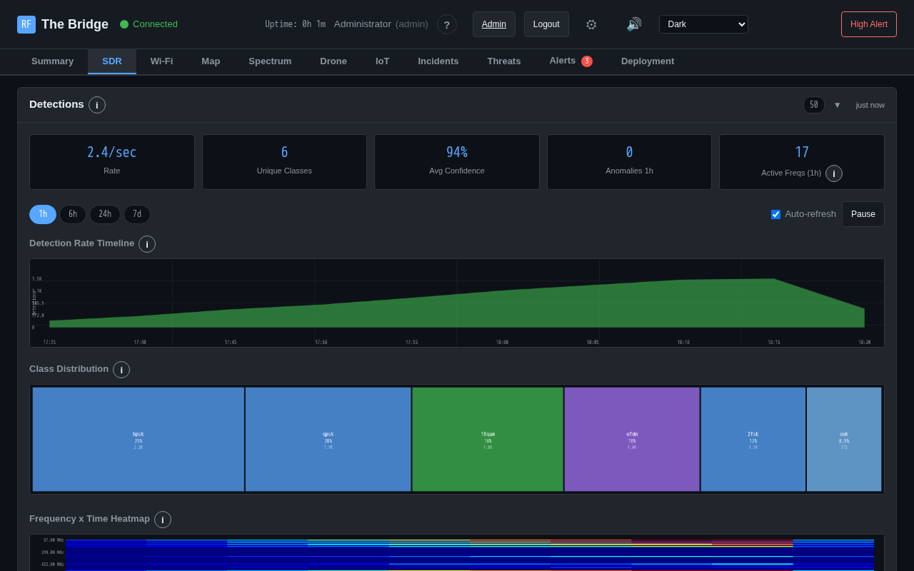
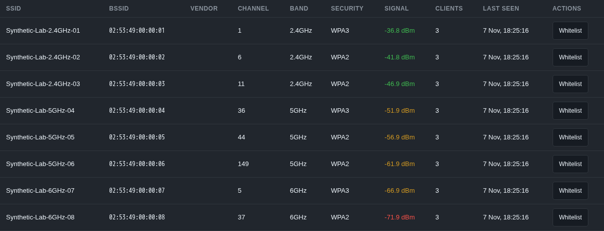
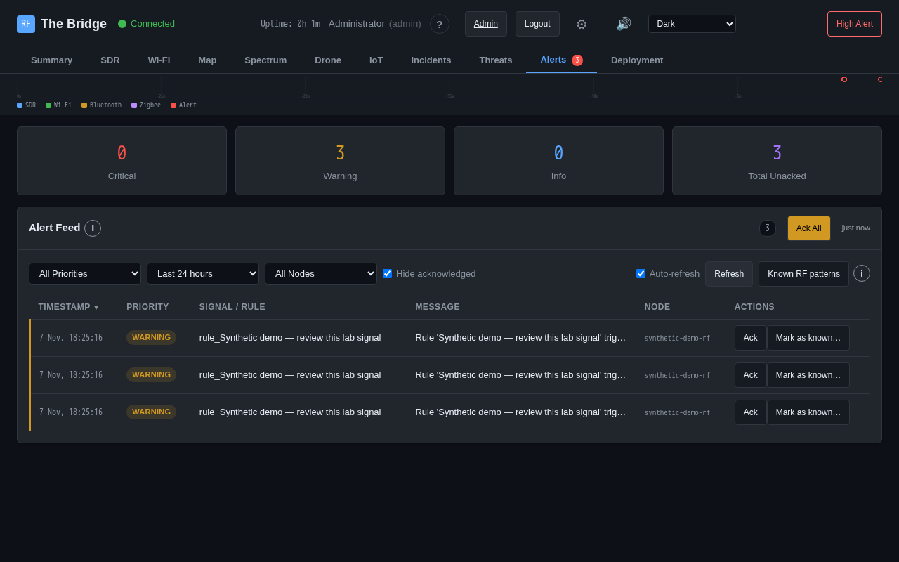
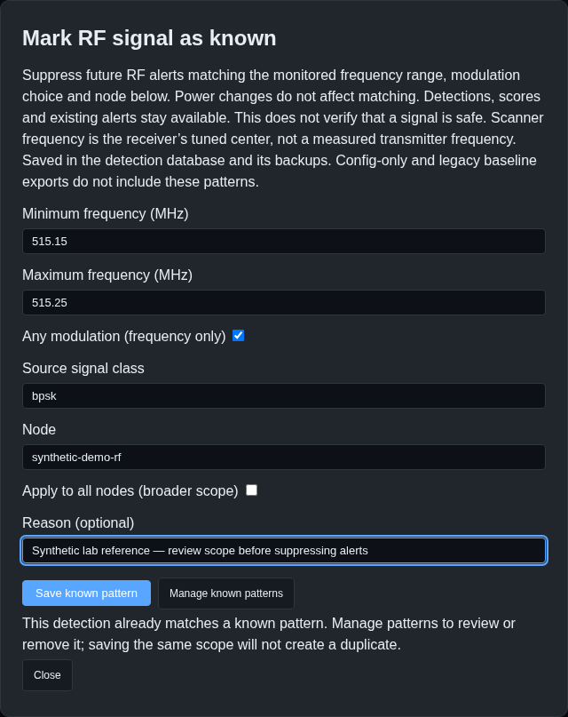
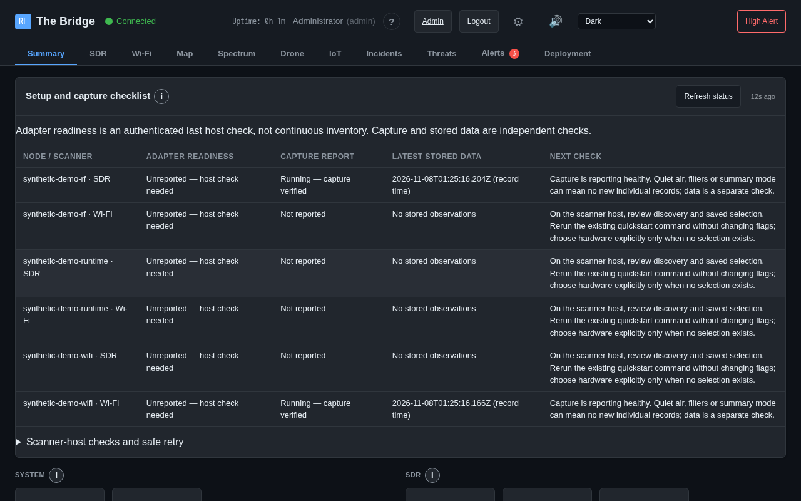
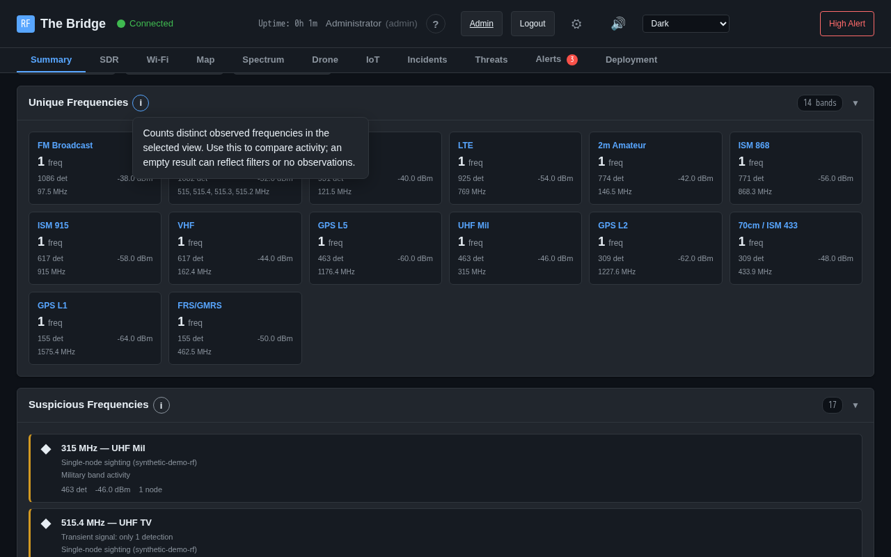

# Application screenshots

These are real Chromium screenshots from disposable SigRift stacks.
Unless specified otherwise, the viewport is 1920 × 1080 at device scale 1,
using the application's dark theme. No screenshot contains a password, API
key, session token, MFA secret, or data from a physical radio capture.

## Feature gallery

These November 8, 2026 (UTC) images show the real application with
labeled synthetic observations. Counts and charts are populated from the
application APIs. They demonstrate the interface and software workflows; they
do not measure radio reception or model accuracy.

The original PNGs are available in two layouts: compact images for README
pages and larger images for documentation or promotional layouts. Keep the
synthetic-data caption when reusing them. Image hashes, dimensions, captions
and capture limits are recorded in [the capture manifest](features/manifest.json).

### Frequency overview

Fourteen populated bands make it easy to see where observations cluster,
how often they occur and their average received power. Band names identify
frequency ranges; they do not establish a signal's protocol.

[Full-size frequency overview](features/frequency-hero-full.png)

### Summary metrics

System, SDR and Wi-Fi metrics populated with synthetic observations. Inactive
scanner sections are hidden. Detection rate is a window average, not a receiver
throughput benchmark. The Wi-Fi anomaly count matches the active review queue;
a displayed zero is an actual API result, not missing data.

[Full-size Summary metrics](features/summary-metrics-full.png)

### SDR activity

Timeline and modulation distribution calculated from timestamped synthetic
RF detections. **Active Freqs (1h)** is the server count of positive raw
frequencies grouped into 100 kHz bins over the fixed last hour. It does not
depend on how many recent feed rows are visible or the selected chart range.
Scanner records can describe the receiver's tuned center; this count does not
establish occupied channels or distinct emitters. The KPI, timeline and class
panels are fully visible; the lower heatmap continues below the viewport.

[Full-size SDR dashboard](features/sdr-analytics-full.png)

### Wi-Fi discovery

Eight synthetic networks and 24 synthetic clients across three bands. Network
names and locally administered addresses belong to the fixture.

[Full-size Wi-Fi dashboard](features/wifi-networks-full.png)

### Alerts and known frequencies

The condition engine creates these alerts from synthetic RF observations.
Reviewing a frequency interval as known can suppress future matching RF alerts
across modulation changes. The rule is scoped to a selected node and range;
raw detections remain available. This is operator-reviewed suppression, not an
automatic detector of newly occupied spectrum.

[Full-size alerts](features/alerts-full.png)

Both review images include every field, action, status message and the Close
button. The compact capture uses a taller viewport to keep the whole dialog
visible without changing the interface.

[Full-size known-frequency review](features/known-pattern-full.png)

### Setup checklist and panel help

The checklist separates scanner reports, received observations and host
readiness. These examples use synthetic scanner reports; they do not claim
physical hardware readiness. Information buttons explain each panel's purpose
and how to interpret its contents.

[Full-size setup checklist](features/setup-checklist-full.png)

[Full-size panel help](features/panel-help-full.png)
